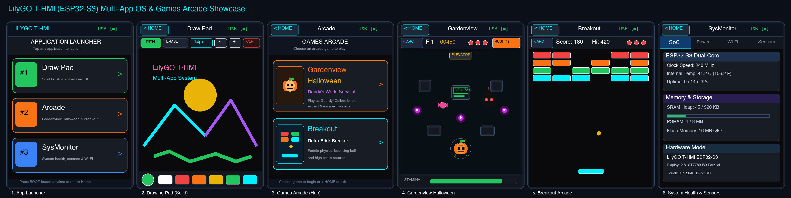
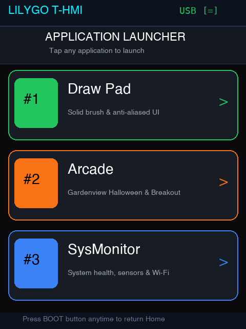
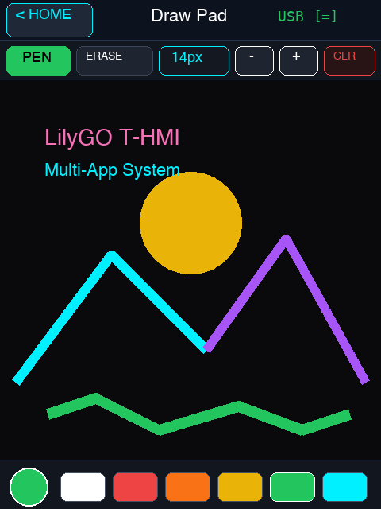
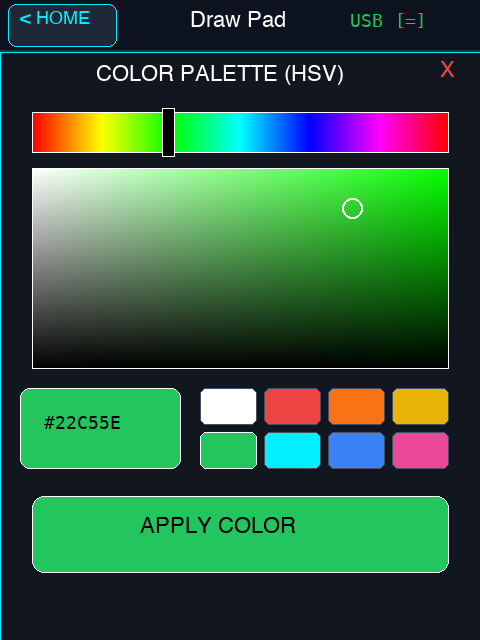
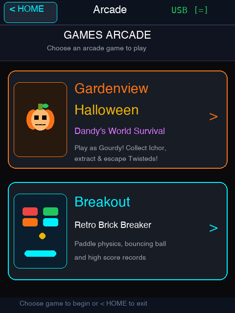
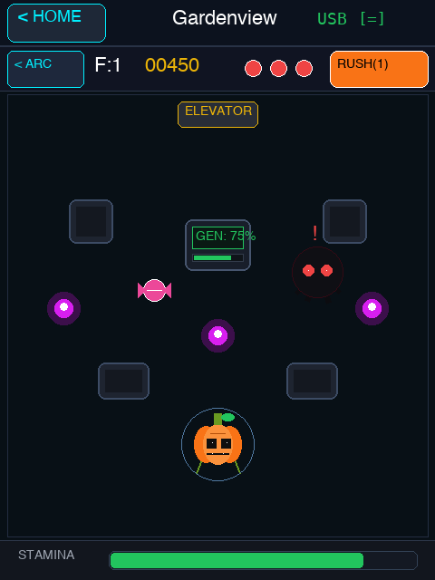
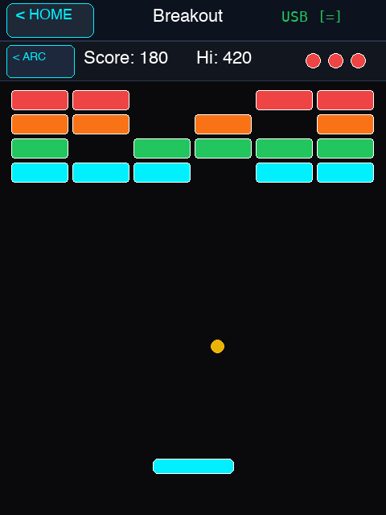
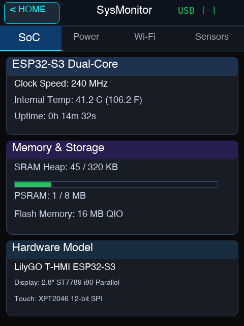
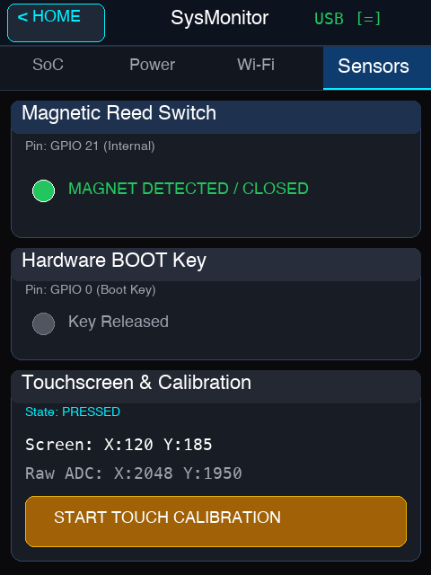

<h1 align="center">🌟 LilyGO T-HMI Multi-App OS 🌟</h1>

<p align="center">
  <b>A responsive multi-application touch operating system for the LilyGO T-HMI ESP32-S3</b><br>
  Featuring Drawing Pad with IbisPaint HSV Color Picker, Games Arcade (Gardenview Halloween & Breakout), System Monitor, and Sub-Pixel Anti-Aliased UI.
</p>

<p align="center">
  
</p>

---

## 📱 Feature Overview

### 1. 🎨 Drawing Pad (`AppDrawingPad`)
- **Solid Crisp Strokes:** Pure, uniform color stroke rendering with zero opacity accumulation at overlapping points—intersections stay clean and vibrant.
- **Smart Jitter Gating:** Sub-pixel jitter filter (< 1.5px) prevents point clumping and stutter when resting or drawing slowly.
- **1-100px Brush Sizing:** Dynamic brush size modal with live anti-aliased preview circle, slider bar, and quick preset buttons (`2px`, `10px`, `25px`, `50px`, `100px`).
- **IbisPaint-Style HSV Color Picker:**
  - Real-time 360° Hue spectrum slider bar.
  - 2D Saturation & Brightness gradient picker field with live crosshair.
  - Quick-access palette pills and live hex/color preview box.
- **PSRAM Persistent Canvas:** 150KB 16-bit RGB565 framebuffer stored in 8MB PSRAM, preserving your artwork when switching between apps or opening modals.

### 2. 🕹️ Games Arcade (`AppArcade`)
A retro touch arcade launcher featuring two complete games with sub-navigation and smooth anti-aliased cards:
- **🎃 Gardenview Halloween (`AppGourdy`):**
  - **Dandy's World Survival:** Play as Gourdy Holloway, the anthropomorphic pumpkin extractor from *Dandy's World*. Features custom multi-lobe pumpkin rendering, moving white pupils that track threats, green stem/leaf, and fanged grin.
  - **Ichor Extraction & Elevators:** Collect glowing purple Ichor drops scattered across Gardenview rooms, activate the central computer extraction terminal (`0% → 100%`), and unlock the elevator door to advance floors.
  - **Twisted Monsters (Aggro AI):** Inky shadow enemies with dripping tendrils and piercing red eyes patrol the arena. Twisteds detect Gourdy and enter high-speed chase mode with alert markers (`!`). Kite them around stone pillars!
  - **Sugar Rush Boost:** Pick up wrapped candies across the map and tap the on-screen `RUSH!` button for an immediate +50% speed boost.
  - **Stamina Management:** Dynamic stamina gauge governs sprinting and evasive maneuvers.
- **🧱 Breakout Arcade (`AppGame`):**
  - **60 FPS Differential Rendering:** Only paddle and ball bounding boxes are redrawn each frame, eliminating LCD tearing.
  - **Touch-Guided Paddle:** Low-pass filter tracking for responsive finger or stylus paddle control.
  - **Arcade Physics:** Realistic brick collisions, variable deflection angles, score tracking, high score memory, and heart-based lives indicator.

### 3. 📊 System Health & Sensor Monitor (`AppSystemMonitor`)
- **SoC Health:** Real-time ESP32-S3 CPU frequency (240MHz), internal silicon die temperature sensor (°C / °F), system uptime, and Flash memory details.
- **Memory Gauges:** Live visual SRAM heap usage bar and 8MB Octal PSRAM allocation.
- **Power Rail & Battery:** LiPo battery voltage sensing via ADC divider (GPIO 5), USB 5V detection, and battery percentage display.
- **Wi-Fi Scanner:** Asynchronous 2.4GHz network scan displaying SSID names and signal strength (RSSI dBm).
- **Hardware Sensors:**
  - **Magnetic Reed Switch (GPIO 21):** Real-time LED detection indicator for external magnetic fields.
  - **BOOT Key (GPIO 0):** Hardware button state detection.
  - **Touchscreen Diagnostics:** Raw 12-bit ADC coordinates (`rx, ry`) alongside mapped screen coordinates (`x, y`).
  - **4-Point Calibration:** Interactive crosshair calibration saved directly to onboard NVS / LittleFS storage.

### 4. ✨ Sub-Pixel Anti-Aliased UI (`UI_AA`)
- Custom graphics engine providing smooth anti-aliased rounded rectangles, circular indicators, and outlines (`UI_AA::fillRoundRect`, `UI_AA::drawRoundRect`, `UI_AA::fillCircle`, `UI_AA::drawCircle`).
- Pre-computed alpha blending (`tft.alphaBlend`) against dark theme surfaces with zero parallel LCD bus read penalties.

---

## 🖼️ Application Gallery

| 1. App Launcher | 2. Drawing Pad (Solid Strokes) | 3. IbisPaint Color Picker |
|:---:|:---:|:---:|
|  |  |  |
| *Card launcher with theme badges* | *Solid brush with persistent PSRAM canvas* | *HSV hue slider & Sat/Val square* |

| 4. Games Arcade Menu | 5. Gardenview Halloween (Dandy's World) | 6. Breakout Arcade Game |
|:---:|:---:|:---:|
|  |  |  |
| *Arcade subgame selector hub* | *Ichor collection, machine extraction & Twisteds* | *60 FPS touch paddle & brick physics* |

| 7. System Monitor (SoC) | 8. Power & Sensors |
|:---:|:---:|
|  |  |
| *Dual-core stats, temp & memory bars* | *Magnetic reed switch & touch calibration* |

---

## 🛠️ Hardware Specifications

- **MCU:** Espressif ESP32-S3 dual-core Tensilica Xtensa LX7 @ 240MHz
- **Display:** 2.8-inch ST7789 LCD (240 × 320 portrait, 8-bit 8080 parallel bus)
- **Touchscreen:** XPT2046 resistive touch controller (SPI)
- **Storage & Memory:** 16MB QIO Flash, 8MB Octal PSRAM, 320KB internal SRAM
- **Connectivity:** 2.4GHz 802.11 b/g/n Wi-Fi & Bluetooth 5 (LE)
- **Peripherals:** Built-in magnetic reed switch (GPIO 21), hardware BOOT button (GPIO 0), battery ADC voltage divider (GPIO 5), USB-C native CDC.

---

## 🚀 Quick Start (PlatformIO)

### 1. Clone Repository
```bash
git clone git@github.com:YoletG/T-HMI-MultiApp.git
cd T-HMI-MultiApp
```

### 2. Compile Firmware
```bash
pio run
```

### 3. Flash to Board
1. Connect the LilyGO T-HMI via USB-C.
2. Hold down the **BOOT** button (Button 1 / GPIO 0) and tap **RST** once, then release **BOOT** to enter ROM bootloader.
3. Flash the firmware:
```bash
pio run -t upload
```

---

## 📌 Board Pinout & Schematic


### Power & Hardware Tips
1. **USB-CDC Serial:** Native USB is used for upload and serial monitoring (`ARDUINO_USB_CDC_ON_BOOT=1`).
2. **External 5V Power:** When using external 5V without USB, set GPIO 14 (`PowerOn Pin`) to `HIGH` upon chip startup.
3. **Battery Power Mode:** When running on LiPo battery power, GPIO 10 must be held `HIGH`.

---

## 📜 License
This project is open-source under the Apache 2.0 / MIT License.